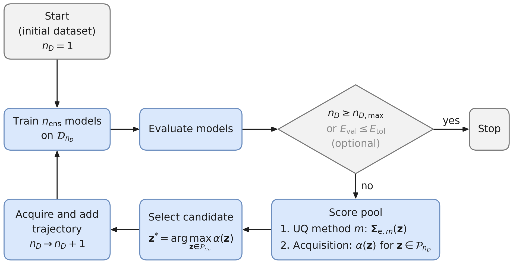

# Active-learning workflow

How the two active-learning (AL) experiments run, step by step, in terms of the trajectory-pool AL loop of the thesis (Figure 3.1). Paths are relative to the repository root.

## The protocol of Figure 3.1



*Figure 3.1 of the thesis (generator: `experiments/03_thermal_food_processing/figures/experiment_graph/al_flowchart.py`). The experiments stop at the fixed budget n_D = n_D,max; the optional tolerance E_val ≤ E_tol is not used. UQ = uncertainty quantification.*

The Random baseline selects uniformly from the same pool. A *path* is one run of this loop (one start, one architecture, one method); the experiments are many paths.

The two experiments implement this protocol with separate workflow code. They share the library in `src/` (Laplace approximation, MoLA, ensembles and the training-RMSE filter, acquisition scores), the launcher and hardware snapshot in `experiments/shared/cluster_recovery/`, and the plotting style. Everything else (plan, state, phases) is specific to the experiment.

Both workflows are built for long cluster runs and therefore share three properties:

- **One phase per process.** A path is not one long Python process. Train, evaluate and acquire of every training-set size are separate calls of a script, each in a fresh process.
- **State on disk.** What is done is recorded by committed result files (JSON with the SHA-256 of the artifacts). A script asks the files, not its memory, what comes next, so a run can be stopped and started again at any time and finished phases are never repeated.
- **Frozen plan.** A plan file fixes the design (starts, seeds, recipes, settings) and the SHA-256 of the data and code files. Every phase checks them and refuses to run if they changed.

---

## Thermal food processing (`experiments/03_thermal_food_processing/al_runs/`)

200 paths = *tasks* in `study/plan.json`: 2 architectures (NODE, sPHNN) × methods × 15 starts. Ten starts run to n_D = 15 (with Random), five to n_D = 5 (without Random). `python control.py progress` lists them.

### Figure 3.1 and the code

| box | where | what it does |
|---|---|---|
| Start | `design.py::warmstarts`, `store.py::state` | the start trajectory of the path (`warmstart_ids` of the plan) is the first element of the training set |
| Train n_ens models | `run.py::train` → `kernels/core/train_common.py::train_ensemble` | K = 3 members from scratch, full-batch Adam (NODE 30k, sPHNN 20k steps, lr 1e-4, L2 1e-6), seeds `7_000_000 + 100_000·path + 1000·(n_D−1) + k` |
| Evaluate models | `run.py::evaluate` | training filter (members whose training RMSE is 5 × the median or more are excluded from the ensemble statistics), then rollouts on the 15 fixed test trajectories (AP15) and member RMSEs in K |
| n_D ≥ n_D,max? | `store.py::state` | returns `done` when the report of the last size exists (`max_N` of the path in the plan) |
| Score pool | `run.py::acquire` → `numerical.py::acquisition_kernels`, `src/active_learning.py` | predictive variance of the two probe temperatures over the rollout of every candidate, then the scores MGE (`score_sum_marginal`) and VAR (`score_sum_variance`) |
| Select candidate | `run.py::acquire` | the candidate with the largest score of the task's criterion (ties: smaller trajectory id) |
| Acquire and add | `selections/iterNN.json`, `store.py::state` | the pick is stored; the next call of `state` appends it to the training set |
| (loop) | `run_local.sh` | the shell loop that starts one phase after the other |

### What runs when

```
run_local.sh TASK                         shell loop, at most MAX_PHASES passes
  |
  |   pass:  run_cpu.sh run.py --task T      fresh process, CPU / float64 / one thread
  |            run():  load plan, check SHA-256 of data and code, lock the path folder
  |                    state(): look at the files of the path folder
  |                       no iterNN_train.json ............ phase train
  |                       no iterNN.json .................. phase evaluate
  |                       no selections/iterNN.json ....... phase acquire
  |                       report of the last size exists .. done (nothing to do)
  |                    run the one phase, commit its files, exit
  |
  +-- control.py done --task T                exit code 0: path complete, loop ends
```

One path, seen over time (iterNN = n_D − 1):

```
 n_D = 1      train  -> evaluate -> acquire --> pick z*_1 ----+
 n_D = 2      train  -> evaluate -> acquire --> pick z*_2 ----+   training set = start + picks
 ...                                                          |
 n_D = max    train  -> evaluate  -> done  (Stop)            <+
```

A path has 3 · n_D,max − 1 phases (44 for n_D,max = 15, 14 for n_D,max = 5).

### Files of a phase (in `al_runs/study/results/<model>/<method>/<criterion>/pathNN/`)

| phase | reads | writes |
|---|---|---|
| (first call) | plan | `manifest.json` (task, plan hash, software versions) |
| train | data, plan | `iterNN.eqx` (the K = 3 trained members), `iterNN_history.pkl` (loss history), `iterNN_train.json` (training ids, seeds, recipe, normalisation, time) |
| evaluate | `iterNN.eqx`, data | `evaluation/iterNN/batch*.{json,npz}` (cached blocks), `iterNN.json` (training filter and member RMSEs per trajectory, subset statistics) |
| acquire | `iterNN.eqx`, `iterNN.json`, data | `acquisition/iterNN/batch*.{json,npz}` (variances and scores per candidate), `acquisition/iterNN/fit_attempt_*.json` (Laplace fit values), `selections/iterNN.json` (pool, ranking by both criteria, pick) |

Index NN is n_D − 1: `iter00` is the first training set (the start trajectory alone).

### Scoring the pool (`acquisition_kernels`)

| method | model(s) around which the variance is computed | variance of a candidate rollout |
|---|---|---|
| DE | the retained members of the ensemble | variance over the members |
| LA | `Laplace_NeuralODESolver` or `Laplace_sPHNNSolver` (`src/models.py`) around member 0, fitted with `fit_laplace_mll` | Laplace variance of the linearised prediction |
| MoLA | the same wrapper around every retained member | mean of the Laplace variances plus variance of the linearised means |

`acquisition_kernels` returns a function `kernel(x0, u)` that gives, for one candidate (initial state and oven control), the total, within-model and between-model variance for every time step and probe. `acquire` evaluates it for all pool candidates in cached blocks and sums the total variance over time steps and probes: `score_sum_marginal` sums the logarithms (MGE), `score_sum_variance` sums the variances (VAR). Both scores are stored for every candidate; the task's criterion decides the pick.

### Differences from Figure 3.1

- **Random** does not draw at every step: the plan fixes, for every path, the order in which Random adds trajectories (`random_orders`), which is a uniform draw without replacement from the same pool.
- **Evaluate** only reports. The test errors never enter the selection, and the tolerance E_val ≤ E_tol is not used; the stop is the fixed budget.
- **Score pool** always computes both criteria. The task's criterion decides the pick; the other ranking is stored as well.
- **Training filter.** A member whose training fit failed is excluded from the ensemble statistics (DE, MoLA) and from the reported ensemble mean; a failed member 0 stops an LA path instead of being replaced.

### Running it

From the repository root (see `experiments/03_thermal_food_processing/al_runs/README.md` for the details and run times):

```bash
python experiments/03_thermal_food_processing/al_runs/control.py progress | head -40   # tasks and their state
bash experiments/03_thermal_food_processing/al_runs/run_local.sh 30 9                  # task 30, first 9 phases (n_D = 1..3)
python tools/compare_local_thermal.py 30                                                  # next to the stored records of the thesis
```

---

## DED (`experiments/04_ded/al_runs/start_study/`)

The same loop, organised differently. All paths of a plan advance together, size by size: a coordinator (`control.py`) collects the work of one training-set size from all paths, removes duplicates, and hands it out as *tasks* (one training or one acquisition each), every task in a fresh process (`worker.py`). A path is one model (NODE, sPHNN), one start trajectory and one *stream*: `LA`, `DE`, `MoLA` or `random0` .. `random5`. Path ids look like `NODE/start12/LA`. The thesis runs have ten starts (the five of `start_study` and the five of `../final_extension`), n_D = 1..5, and the MGE criterion only.

### Figure 3.1 and the code

| box | where | what it does |
|---|---|---|
| Start | `study_design.py::plan`, `control.py::frontier` | the start simulation of the path is the training set at n_D = 1 |
| Train n_ens models | `study_numerical.py::train` → `experiments/shared/al_path_repeats/repeat_adapter.py` → `kernels/core/_ded_al_core.py::train_hybrid_stages` | K = 3 members from scratch on the POD coordinates of the training set (40 modes, fitted on exactly this set): derivative fitting (20k steps), then trajectory fine-tuning (NODE 15k, sPHNN 10k steps) |
| Evaluate models | the same task, `repeat_adapter.py::filter_and_report` | training filter (training RMSE 5 × the median or more), then the Kelvin RMSE of every member on all 25 simulations; stored in `train.json`, published per path by `control.py::publish_paths` |
| n_D ≥ n_D,max? | `control.py::advance_step` | the loop over n_D ends at `--through-N` (at most 5, the `max_N` of the plan) |
| Score pool | `study_numerical.py::acquire` | variance of the rollout of every simulation that is not in the training set, then the MGE score (`src/active_learning.py::score_sum_marginal`) |
| Select candidate | `study_store.py::ranking` | descending score, ties: smaller id; the first entry is the pick (`selection.json`) |
| Acquire and add | `control.py::frontier` | the training set of size n_D + 1 is built from the committed selection of size n_D |

### What runs when

```
run_local.sh PATHS THROUGH_N
  |
  +-- control.py freeze   write plan.json and manifest.json (SHA-256 of data, code, package versions)
  |                       into run/main_local_<hash of the selection>/
  |
  +-- control.py advance  repeat until nothing is left to start:
  |      for n_D = 1 .. THROUGH_N:
  |         frontier(n_D)        the training sets of all paths (start, then the committed picks, or the
  |                              predeclared Random tail) -> unique training requests and acquisition requests
  |         stage reporting      train tasks  : K = 3 ensemble + POD basis + training filter + errors on 25 simulations
  |         stage LA_training    train tasks  : single-member model for the LA paths
  |         publish_paths        paths/<id>/iterNN.json for every path
  |         stage acquire        acquire tasks: LA, DE or MoLA scores of the pool -> selection.json   (not at the last size)
  |      every task:  run_cpu.sh worker.py --run ... --batch ... --task k     (fresh process, one after another)
  |
  +-- control.py progress  completed size of every path
```

Identical training requests are trained once: all paths of a model and start share the n_D = 1 ensemble, and any other ensemble with the same training set and key is trained once as well. A path record then points to the shared training.

### Files of a run (`run/main_local_<hash>/`)

| folder / file | content |
|---|---|
| `plan.json`, `manifest.json` | the frozen plan and the hashes it was frozen with; every task checks them |
| `frontiers/N01.json`, `N02.json`, … | all requests of one training-set size (trainings, acquisitions, which path needs what) |
| `shared/<request id>/` | one training: `model.eqx` (members), `pod.npz` (POD basis), `history.pkl`, `train.json` (training filter, member errors, seeds, timings) |
| `acquisitions/<request id>/` | `selection.json` (pool, ranking, pick); LA: `calibration.npz` (Laplace fit); MoLA: `components/` and `pool_moments.npz` |
| `paths/<path id>/iterNN.json` | record of a path at size NN + 1 (training ids, errors, the pick it leads to); links to the shared files |
| `batches/`, `submissions/`, `failures/` | the task lists that were run, and diagnostics of a failed task |

### Scoring the pool (`study_numerical.py::acquire`)

| method | model | variance of a candidate rollout |
|---|---|---|
| LA | a separate single-member model (key `9_500_000 + …`, trained on the same POD basis as the reporting ensemble) | exact linearised Laplace variance after `fit_laplace_mll` (`_ded_al_core.py::fit_single_seed_laplace`, `score_pool_sum_marginal`) |
| DE | the retained members of the reporting ensemble | empirical variance over the members (`reporting.py::score_pool_de`) |
| MoLA | the retained reporting members 0, 1, 2, each with its own Laplace approximation, in separate processes (`kernels/mola_acquisition/`) | uniform mixture: mean of the Laplace variances plus variance of the means (`moments.py`) |

### Differences from Figure 3.1

- **Evaluate** is part of the training task, and the test set is the full set of 25 simulations, including the training and pool simulations. There is no held-out test set; the errors are only reported.
- **Random** paths have no acquisition tasks: their training sets follow a predeclared order (`study_design.py::tail`).
- **Stop** is a command-line limit of the coordinator, not a decision of the path.

### Running it

From the repository root (details, run times and memory in `experiments/04_ded/al_runs/start_study/README.md`):

```bash
bash experiments/04_ded/al_runs/start_study/run_local.sh NODE/start12/LA 2     # up to n_D = 2, about 35 minutes
python tools/compare_local_ded.py NODE/start12/LA                               # next to the stored records of the thesis
```

---

## How the two workflows differ

| | thermal food processing | DED |
|---|---|---|
| unit of work | one phase of one path (`run.py --task T`) | one training or acquisition of a batch shared by many paths (`worker.py --task k`) |
| who advances the loop | the shell loop in `run_local.sh`, path by path | the coordinator `control.py advance`, all paths size by size |
| state | files of the path folder, read by `store.py::state` | frontier files and committed results, read by `control.py::frontier` |
| data representation | temperatures at two probes, driven by the oven temperature | spatial temperature field reduced to 40 POD coordinates, refitted for every training set |
| training | one stage, full batch | derivative fitting, then trajectory fine-tuning |
| evaluation | 15 fixed test trajectories (AP15), never selected | all 25 simulations, including the training ones |
| LA | Laplace approximation around member 0 of the reporting ensemble | separate single-member model |
| criteria | MGE and VAR (both stored) | MGE |
| shared work | none (every path trains its own ensembles) | identical training requests are trained once |
